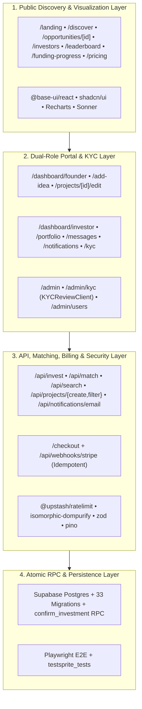

# Fakret Mashrou (`fakret-mashrou-final-`) — Arabic Startup Pitch, KYC & Investor Deal-Flow Platform

<p align="center">
  
</p>

## Table of Contents
- [Executive Summary & Business Utility](#executive-summary--business-utility)
- [Visual Showcase (UI & Dashboards)](#visual-showcase-ui--dashboards)
- [System Architecture & Layers](#system-architecture--layers)
- [Data Model & Atomic Investment Guarantees](#data-model--atomic-investment-guarantees)
- [Database Schema, Migrations & RLS](#database-schema-migrations--rls)
- [Application Modules & API Endpoints](#application-modules--api-endpoints)
- [Getting Started & Scripts](#getting-started--scripts)
- [Business Value, ROI & Growth Opportunities](#business-value-roi--growth-opportunities)

---

## Executive Summary & Business Utility
`fakret-mashrou-final-` (`arabic-platform`) is a production-grade Next.js 16 and Supabase startup fundraising and investor matching marketplace. Founders pitch ideas (`/add-idea`), complete identity verification (`/kyc`), and manage capital raises (`/dashboard/founder`), while investors discover vetted opportunities (`/discover`, `/opportunities/[id]`, `/leaderboard`), execute race-condition-safe investments (`/api/invest`), and track portfolios (`/dashboard/investor`)—backed by Upstash rate limiting, Stripe webhook idempotency, and structured Pino logging.

---

## Visual Showcase (UI & Dashboards)
Brand identity (`public/LOGO.svg`) and key interactive surfaces:
- **Founder & Investor Portals**: `/dashboard/founder`, `/dashboard/investor`, `/funding-progress` (Recharts visualizations)
- **Deal Discovery & Trust**: `/discover`, `/opportunities/[id]`, `/leaderboard`, `/kyc`, `/admin/kyc`

---

## System Architecture & Layers



| Layer | Responsibility | Key Files |
| :--- | :--- | :--- |
| **Marketplace & Charts Layer** | Opportunity discovery, funding progress charts (`recharts`), leaderboards, and blog | `app/{discover,opportunities,investors,leaderboard,funding-progress}/page.tsx` |
| **Founder & Investor Workspaces** | Role dashboards, project editing, saved deals, messaging, and notifications | `app/dashboard/{founder,investor}/page.tsx`, `app/{add-idea,messages,notifications,portfolio}/page.tsx` |
| **API & Security Layer** | 10 route handlers protected by Upstash rate limiting, DOMPurify sanitization, and Pino structured logs | `app/api/{auth,invest,match,notifications,projects,search,webhooks}/**` |
| **Atomic Database & RPC Layer** | Race-condition-free investment confirmation (`confirm_investment` RPC), webhook idempotency, FX rates, and audit logs | `migrations/*.sql`, `supabase/migrations/*.sql` |
| **E2E Verification Layer** | Playwright end-to-end tests and TestSprite specs | `tests/`, `testsprite_tests/` |

---

## Data Model & Atomic Investment Guarantees
- **Concurrency Safety**: `20260426_create_confirm_investment_rpc.sql` and `20260426_fix_investment_race.sql` prevent double-allocation / oversubscription during concurrent investments.
- **Webhook Idempotency**: `20260426_add_webhook_idempotency.sql` logs processed Stripe events in `stripe_webhook_events` to guarantee at-most-once billing updates.

---

## Database Schema, Migrations & RLS
33 SQL migration files across `migrations/` and `supabase/migrations/`:

| Table | Purpose |
| :--- | :--- |
| `profiles`, `kyc_verifications`, `kyc_data` | User accounts, roles (Founder/Investor/Admin), and KYC compliance records |
| `projects`, `investments`, `payouts`, `exchange_rates` | Startup listings, investment commitments, payout ledgers, and currency conversion |
| `messages`, `saved_opportunities`, `notifications`, `notification_preferences`, `contact_messages` | Deal-room communications, watchlists, and alert preferences |
| `stripe_webhook_events`, `audit_logs` | Payment idempotency and security/compliance audit trails |

---

## Application Modules & API Endpoints

| Endpoint | Purpose |
| :--- | :--- |
| `/api/auth/{login,register}` & `/auth/callback` | Authentication & OAuth callback |
| `/api/projects/create` & `/api/projects/filter` | Project submission & multi-criteria filtering |
| `/api/invest` | Atomic investment commitment handler |
| `/api/match` & `/api/search` | Founder-investor matching & platform search |
| `/api/notifications/email` | Transactional notification dispatch |
| `/api/webhooks/stripe` | Idempotent Stripe payment webhook handler |

---

## Getting Started & Scripts

```bash
git clone https://github.com/islamsamyy/fakret-mashrou-final-.git
cd fakret-mashrou-final-
npm install
npm run dev
```

| Script | Command | Description |
| :--- | :--- | :--- |
| Dev | `npm run dev` | Start Next.js 16 dev server |
| Build | `npm run build` | Production build |
| Lint | `npm run lint` | Run ESLint |

---

## Business Value, ROI & Growth Opportunities
- **Institutional-Grade Deal Integrity**: Atomic investment RPCs and Stripe idempotency make the platform safe for real financial transactions—not just a demo.
- **Syndicate & Carry Monetization**: Charge platform success fees on closed rounds, featured listing fees via `/checkout`, and premium investor subscriptions (`/pricing`).
- **Automated AI Due Diligence**: Extend `/api/match` to score pitch decks and financial projections before admin KYC review.
