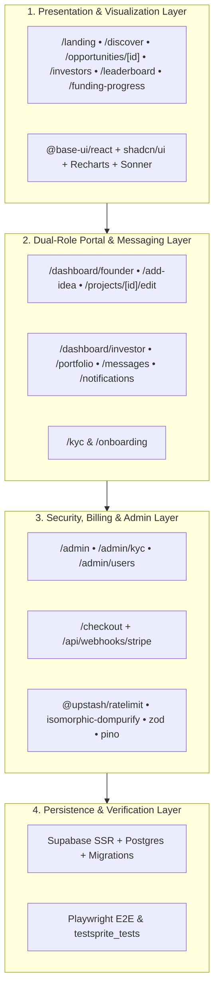

# Fakret Mashrou (`fakret-mashrou-final-`) — Arabic Startup Pitch, KYC & Investor Matching Platform

A production-oriented Next.js 16 (`arabic-platform`) and Supabase investment marketplace enabling Arab founders to pitch validated business ideas, pass KYC verification, track funding progress, and connect with investors—protected by Upstash rate limiting, Stripe billing, and structured Pino logging.

---

## 1. Executive Summary & Purpose
`fakret-mashrou-final-` bridges the funding gap between early-stage MENA entrepreneurs and angel/seed investors. Founders submit structured pitches (`/add-idea`, `/projects/[id]/edit`), investors browse vetted deal flow (`/discover`, `/opportunities/[id]`, `/investors`, `/leaderboard`), and platform admins enforce trust through a dedicated KYC review pipeline (`/kyc`, `/admin/kyc`).

---

## 2. System Architecture & Layers



| Layer | Responsibility | Key Files |
| :--- | :--- | :--- |
| **Marketplace & Discovery Layer** | Public deal-flow discovery, opportunity detail views, leaderboards, and funding progress charts | `app/{discover,opportunities,investors,leaderboard,funding-progress,how-it-works}/page.tsx` |
| **Founder & Investor Workspaces** | Role-specific dashboards, idea submission/editing, portfolio tracking, real-time messaging, and notifications | `app/dashboard/{founder,investor}/page.tsx`, `app/{add-idea,messages,notifications,portfolio}/page.tsx` |
| **Compliance & Admin Layer** | Identity verification workflow (`KYCReviewClient.tsx`) and user governance | `app/kyc/page.tsx`, `app/admin/kyc/{page,actions,KYCReviewClient}.tsx`, `app/admin/users/page.tsx` |
| **Security, Rate-Limiting & Billing** | Upstash Redis rate limiting, XSS sanitization (`isomorphic-dompurify`), Stripe checkout/webhooks, Pino logs | `app/checkout/*`, `app/api/webhooks/stripe/route.ts` |
| **Data & E2E QA Layer** | Supabase migrations (`migrations/`, `supabase/`) and Playwright browser test suites | `tests/`, `testsprite_tests/`, `migrations/` |

---

## 3. Core Functionality & Modules
- **Founder Pitch & Lifecycle**: Submit startup concepts (`/add-idea`), edit active listings (`/projects/[id]/edit`), and monitor investor interest via `/dashboard/founder`.
- **Investor Deal Room**: Explore opportunities (`/discover`, `/opportunities/[id]`), inspect funding milestones (`/funding-progress`), and manage holdings (`/portfolio`, `/dashboard/investor`).
- **Trust & KYC Pipeline**: Self-service `/kyc` submission paired with `/admin/kyc` approval actions.
- **Direct Messaging & Alerts**: Built-in `/messages` and `/notifications` keep deal discussions on-platform.
- **Monetization**: `/pricing` & `/checkout` backed by Stripe webhook fulfillment (`/api/webhooks/stripe`).

---

## 4. Project Structure
```text
├── app/
│   ├── add-idea/ & projects/[id]/edit/  # Founder pitch creation & management
│   ├── admin/                           # Admin overview, kyc review, users
│   ├── api/webhooks/stripe/             # Stripe payment webhook handler
│   ├── checkout/                        # Payment & success flows
│   ├── dashboard/{founder,investor}/    # Role-based dashboards
│   ├── discover/, opportunities/, investors/, leaderboard/, funding-progress/
│   ├── kyc/, onboarding/, profile/[id]/
│   └── messages/, notifications/, blog/, pricing/, contact/
├── components/, hooks/, lib/
├── migrations/ & supabase/              # Database schema & migrations
└── tests/ & testsprite_tests/           # Playwright & integration tests
```

---

## 5. Getting Started

```bash
git clone https://github.com/islamsamyy/fakret-mashrou-final-.git
cd fakret-mashrou-final-
npm install
npm run dev
```

---

## 6. Business Value & Growth Opportunities
- **Success-Fee & Subscription Hybrid**: Monetize via founder pitch-boost packages (`/checkout`), investor pro memberships (`/pricing`), and syndicate carry/success fees on funded deals.
- **AI Pitch Deck & Financial Readiness Scorer**: Automatically grade submitted ideas before they appear on `/leaderboard` to protect investor deal-flow quality.
- **Sharia-Compliant Equity & Revenue-Share Templates**: Offer standardized regional term sheets inside `/opportunities/[id]` to accelerate deal closing across MENA.
- **Data Room Integration**: Add NDA-gated document vaults inside `/projects/[id]` for verified KYC investors only.
